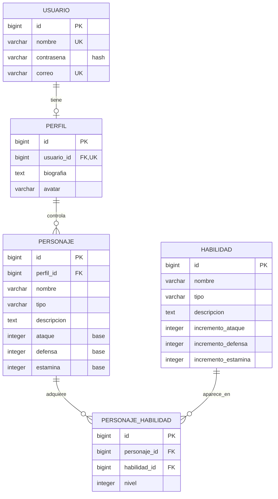

# Actividad 09: modelo de base de datos del juego de rol

## 1. Qué se implementó

La aplicación de la actividad anterior guardaba personajes y habilidades en listas de Python (`juego/datos.py`). Las modificaciones se perdían al reiniciar el proceso. Ahora la API usa el ORM de Django para guardar y consultar registros en SQLite.

El trabajo se hizo en **`mi_proyecto_routing`**, el proyecto que contiene la aplicación `juego` y el archivo que tenías abierto. La carpeta `mi_proyecto` y el ZIP corresponden a ejercicios anteriores y no son los que debes ejecutar para esta entrega.

Se implementaron:

- Los modelos `Usuario`, `Perfil`, `Personaje`, `Habilidad` y `PersonajeHabilidad`.
- Relaciones uno a uno, uno a muchos y muchos a muchos con un atributo adicional.
- Una migración inicial para crear las tablas y sus restricciones.
- Un fixture JSON con los personajes y habilidades del ejercicio anterior, dos usuarios y sus perfiles.
- Los ocho endpoints solicitados en el documento, además del CRUD del catálogo de habilidades y los filtros anteriores.
- Validaciones, respuestas de error JSON y registro de modelos en el administrador de Django.
- Una colección importable en Postman y pruebas automatizadas de Django.
- Configuración opcional de MySQL mediante variables de entorno.

## 2. Cómo ejecutar el proyecto

Abre PowerShell en la raíz del repositorio, donde está este Markdown. El entorno virtual existente permite ejecutar lo siguiente sin activarlo:

```powershell
.\.venv\Scripts\python.exe -m pip install -r requirements.txt
.\.venv\Scripts\python.exe mi_proyecto_routing\manage.py migrate
.\.venv\Scripts\python.exe mi_proyecto_routing\manage.py loaddata datos_iniciales
.\.venv\Scripts\python.exe mi_proyecto_routing\manage.py runserver
```

Si estás en otra máquina y todavía no tienes `.venv`, instala Python compatible con la versión de Django de `requirements.txt` y crea el entorno primero:

```powershell
py -m venv .venv
```

Las dependencias se fijaron a la versión encontrada en el entorno de este repositorio: Django 6.1.1. Puedes comprobar tu instalación con:

```powershell
.\.venv\Scripts\python.exe -m django --version
```

Prueba en el navegador:

```text
http://127.0.0.1:8000/api/personajes
http://127.0.0.1:8000/api/personajes/1
http://127.0.0.1:8000/api/usuarios/1/personajes
http://127.0.0.1:8000/api/habilidades
```

Las rutas también funcionan con `/` al final, incluso para POST, PUT y DELETE. Los cuerpos de esas solicitudes deben enviarse como JSON, con `Content-Type: application/json`.

**`loaddata` es una carga inicial, no un comando que debas ejecutar antes de cada arranque.** Volver a cargar el fixture sobrescribe los registros que tengan las mismas claves primarias; tampoco elimina registros adicionales que hayas creado. Para el uso diario basta con `runserver`.

## 3. Diagrama entidad-relación



`PK` es clave primaria, `FK` es clave foránea y `UK` indica unicidad. Además de su `id`, la tabla intermedia tiene una restricción única sobre el par `(personaje_id, habilidad_id)`.

### Usuario y Perfil: uno a uno

`Perfil.usuario` usa `OneToOneField`. Un perfil pertenece a un usuario y no se pueden crear dos perfiles para el mismo usuario. El acceso inverso es `usuario.perfil`.

La relación garantiza **como máximo un perfil por usuario**; por sí sola no crea perfiles automáticamente ni obliga a que todo usuario tenga uno. El fixture sí crea un perfil para cada usuario de ejemplo. La API devuelve una lista vacía cuando un usuario existente todavía no tiene perfil o personajes.

`Usuario` hereda de `models.Model`, tal como pide la guía. No hereda de `AbstractUser`, no cambia `AUTH_USER_MODEL` y no implementa inicio de sesión. Los usuarios del administrador siguen siendo los del sistema de autenticación de Django.

`contrasena` almacena un hash. El método `save()` transforma valores de texto plano en hashes y conserva los hashes que ya estén codificados. El fixture ya incluye hashes porque `loaddata` no ejecuta el `save()` personalizado. La API de usuarios no devuelve ese campo. No se implementaron endpoints de autenticación.

### Perfil y Personaje: uno a muchos

`Personaje.perfil` usa `ForeignKey`: un personaje pertenece a un perfil y un perfil puede controlar varios personajes. El acceso inverso es `perfil.personajes.all()`.

Para obtener los personajes de un usuario se recorre la relación:

```python
Personaje.objects.filter(perfil__usuario_id=1)
```

El doble guion bajo permite navegar relaciones en las consultas del ORM. Cada personaje necesita un perfil existente.

### Personaje y Habilidad: muchos a muchos

`Personaje.habilidades` usa `ManyToManyField` con `through='PersonajeHabilidad'`. La tabla intermedia explícita permite guardar el nivel que **ese personaje** tiene en **esa habilidad**.

Por ejemplo, dos personajes pueden compartir Espadazo, uno con nivel 1 y otro con nivel 3. El nivel no pertenece al catálogo `Habilidad`, pues varía según el personaje.

`nivel` tiene valor predeterminado 1, un validador mínimo de 1 y una restricción `CHECK` equivalente en la base. Un `PositiveIntegerField` por sí solo admite cero; por eso se agregó la restricción explícita. La unicidad del par impide asignaciones duplicadas incluso si se escribe fuera de la API.

### Qué ocurre al borrar

Las claves foráneas usan `on_delete=models.CASCADE`:

- Borrar un usuario mediante el ORM elimina su perfil, sus personajes y las asignaciones de esos personajes.
- Borrar un personaje elimina sus asignaciones, conservando el perfil y el catálogo de habilidades.
- Borrar una habilidad del catálogo elimina las asignaciones de esa habilidad, conservando los personajes.
- Quitar una habilidad de un personaje borra solamente la fila intermedia.

## 4. Cómo funcionan los atributos y niveles

La guía pide incrementar los atributos al adquirir habilidades, pero no fija una fórmula por nivel. Para esta implementación se eligió:

```text
atributo efectivo = atributo base + suma(incremento de cada habilidad × nivel adquirido)
```

Los campos de `Personaje` guardan los valores **base**. Las respuestas JSON incluyen `ataque`, `defensa` y `estamina` efectivos y un objeto `atributos_base` que muestra los valores almacenados.

Ejemplo del personaje 1 del fixture:

| Atributo | Base | Espadazo nivel 1 | Escudo de Hierro nivel 1 | Efectivo |
|---|---:|---:|---:|---:|
| Ataque | 80 | +10 | 0 | 90 |
| Defensa | 70 | 0 | +15 | 85 |
| Estamina | 60 | -5 | -3 | 52 |

Los incrementos admiten números negativos, tal como los datos anteriores. Los valores base deben ser enteros no negativos. Un valor efectivo puede quedar negativo si las penalizaciones superan la base; no se agregó un límite de combate que el documento no define.

Calcular los efectivos evita sumar dos veces una habilidad al consultar o cargar fixtures. También hace que quitar una habilidad retire automáticamente su efecto y que editar el catálogo actualice las bonificaciones en la siguiente consulta. `PUT` recibe valores base; no copies los valores efectivos de un GET como si fueran base.

Una habilidad duplicada devuelve `409`. No cambia el nivel existente. Para cambiar el nivel desde la API puedes quitar la relación y volver a agregarla, o editarla en el administrador. La guía no exige un endpoint específico de actualización del nivel.

## 5. Endpoints y contrato de entrada

URL base: `http://127.0.0.1:8000/api`.

| Método | Ruta | Resultado correcto |
|---|---|---|
| GET | `/personajes` | `200`, lista de personajes con habilidades y niveles |
| GET | `/usuarios/{id}/personajes` | `200`, personajes del usuario indicado |
| GET | `/personajes/{id}` | `200`, detalle con habilidades y nivel de cada una |
| POST | `/personajes` | `201`, personaje creado con ID automático |
| PUT | `/personajes/{id}` | `200`, personaje actualizado |
| POST | `/personajes/{id}/habilidades` | `201`, personaje con la habilidad agregada |
| DELETE | `/personajes/{idP}/habilidades/{idH}` | `204`, relación eliminada, sin cuerpo |
| DELETE | `/personajes/{id}` | `204`, personaje eliminado, sin cuerpo |
| GET | `/usuarios` | `200`, usuarios sin contraseñas |
| GET | `/personajes/{id}/habilidades` | `200`, habilidades adquiridas y niveles |
| GET / POST | `/habilidades` | `200` para listar / `201` para crear |
| GET / PUT / DELETE | `/habilidades/{id}` | `200` / `200` / `204` |

Las listas son arreglos JSON sin paginación para mantener el alcance del taller. No se implementaron altas de usuarios y perfiles por API: estos se cargan con fixtures o se administran en Django.

### Crear un personaje

POST `/api/personajes`:

```json
{
  "perfil_id": 1,
  "nombre": "Aria",
  "tipo": "maga",
  "descripcion": "Aprendiz de magia del bosque.",
  "ataque": 30,
  "defensa": 20,
  "estamina": 70
}
```

Todos los campos son obligatorios excepto `tipo`. El perfil debe existir. No envíes `id`: lo asigna la base de datos. Las habilidades se agregan mediante su propio endpoint. Usa el `id` de la respuesta en los siguientes ejemplos.

### Editar un personaje

PUT `/api/personajes/{id}`:

```json
{
  "nombre": "Aria del bosque",
  "descripcion": "Maga especializada en protección.",
  "ataque": 35,
  "defensa": 25,
  "estamina": 75
}
```

Los cinco campos son obligatorios. `tipo` es opcional y se conserva si no se envía. Este endpoint no cambia el perfil ni las habilidades del personaje.

### Agregar una habilidad

POST `/api/personajes/{id}/habilidades`:

```json
{
  "habilidad_id": 4,
  "nivel": 2
}
```

`habilidad_id` es obligatorio y debe existir. `nivel` es opcional, predeterminado 1 y debe ser un entero entre 1 y 2147483647. El nivel queda guardado en `PersonajeHabilidad`.

### Crear o editar una habilidad del catálogo

POST `/api/habilidades` o PUT `/api/habilidades/{id}`:

```json
{
  "nombre": "Aura protectora",
  "descripcion": "Mejora la resistencia del personaje.",
  "incremento_ataque": 0,
  "incremento_defensa": 8,
  "incremento_estamina": 5
}
```

Los cinco campos son obligatorios; también se acepta `tipo` opcional. Los incrementos son enteros con signo. Para facilitar el cambio a MySQL, la API limita los enteros al rango de 32 bits correspondiente, aunque SQLite pueda almacenar números mayores.

### Filtros conservados

```text
GET /api/personajes?nombre=Gagh
GET /api/personajes?tipo=guerrero
GET /api/personajes?nombre=Gagh&tipo=guerrero
GET /api/habilidades?nombre=Espadazo
GET /api/habilidades?tipo=combate
GET /api/habilidades?orden=estamina
```

`nombre` busca coincidencias parciales; `tipo` busca igualdad sin distinguir mayúsculas. El orden por estamina se aplica al incremento de estamina de la habilidad, de mayor a menor. Las habilidades iniciales no tenían `tipo`, por lo que ese campo queda vacío hasta que lo asignes.

### Errores previstos

| Código | Cuándo aparece |
|---|---|
| 400 | JSON inválido, campos faltantes/desconocidos, tipos incorrectos, texto vacío obligatorio o valores fuera de rango |
| 404 | Usuario, perfil, personaje o habilidad inexistente; relación no adquirida |
| 405 | Método no admitido, con encabezado `Allow` |
| 409 | El personaje ya tiene la habilidad |
| 415 | El cuerpo de una operación de escritura no usa `application/json` |

Los errores de las vistas de la API se devuelven como JSON con la clave `error`; las validaciones de modelos pueden incluir `detalles`. Una URL que no corresponda a ninguna ruta sigue usando el 404 estándar de Django.

La API usa `csrf_exempt` para las operaciones del ejercicio desde Postman. Está pensada para desarrollo local, sin autenticación ni permisos implementados. `DEBUG=True` y el servidor de desarrollo corresponden a ese alcance.

## 6. Para qué sirve cada archivo

Las rutas de esta tabla parten de la raíz del repositorio.

| Archivo | Función |
|---|---|
| `requirements.txt` | Fija la dependencia de Django usada en el proyecto. SQLite viene con Python. |
| `.gitignore` | Evita versionar entornos, cachés, archivos compilados y variables locales. |
| `mi_proyecto_routing/manage.py` | Entrada a comandos como `migrate`, `loaddata`, `test`, `createsuperuser` y `runserver`. |
| `mi_proyecto_routing/mi_proyecto_routing/settings.py` | Configuración del proyecto: aplicaciones, middleware y conexión SQLite o MySQL. `juego` ya estaba registrado en `INSTALLED_APPS`. |
| `mi_proyecto_routing/mi_proyecto_routing/urls.py` | Rutas generales: `/admin/` y prefijo `/api/`, que incluye las rutas del juego. |
| `mi_proyecto_routing/mi_proyecto_routing/asgi.py` | Punto de entrada para servidores compatibles con ASGI. |
| `mi_proyecto_routing/mi_proyecto_routing/wsgi.py` | Punto de entrada para servidores compatibles con WSGI. |
| `mi_proyecto_routing/juego/apps.py` | Identifica la aplicación `juego` para Django. |
| `mi_proyecto_routing/juego/models.py` | Define entidades, campos, relaciones, hashes de contraseña y restricciones. |
| `mi_proyecto_routing/juego/migrations/0001_initial.py` | Describe cómo construir el esquema inicial de tablas y restricciones. Se generó con `makemigrations`. |
| `mi_proyecto_routing/juego/migrations/__init__.py` | Hace que Django reconozca la carpeta de migraciones como paquete Python. |
| `mi_proyecto_routing/juego/fixtures/datos_iniciales.json` | Datos iniciales con el formato `model`, `pk` y `fields` que espera `loaddata`. |
| `mi_proyecto_routing/juego/serializers.py` | Convierte modelos a diccionarios JSON y calcula los atributos efectivos con sus bonificaciones. Es código propio, sin Django REST Framework. |
| `mi_proyecto_routing/juego/views.py` | Recibe solicitudes, valida JSON, consulta/escribe con el ORM y construye respuestas HTTP. Incluye control de métodos y errores. |
| `mi_proyecto_routing/juego/urls.py` | Conecta cada ruta con su vista, con y sin barra final. |
| `mi_proyecto_routing/juego/admin.py` | Permite gestionar los cinco modelos desde el administrador; incluye edición de habilidades dentro del personaje. |
| `mi_proyecto_routing/juego/tests.py` | Pruebas de integración de rutas, persistencia, relaciones, validación y restricciones de base de datos. |
| `mi_proyecto_routing/juego/datos.py` | Referencia histórica de las listas anteriores. La API ya no lo importa ni lo usa para almacenar cambios. |
| `mi_proyecto_routing/db.sqlite3` | Archivo local con tablas y registros persistidos. Las migraciones y el fixture permiten reconstruirlo. |
| `postman/actividad_09.postman_collection.json` | Contrato ejecutable con ejemplos y aserciones para probar la API en orden. |
| `postman/resultado_local.json` | Resumen de la ejecución real con Newman: estados HTTP, aserciones, fecha local y resultados. |
| `ACTIVIDAD_09_MODELO_BASE_DATOS.md` | Esta explicación de implementación, ejecución, endpoints y conceptos para la sustentación. |

Los demás `__init__.py` identifican paquetes Python. `READ.md`, el ZIP y el proyecto `mi_proyecto` se conservan como parte del material anterior.

## 7. Migraciones y fixture: diferencias importantes

Un **modelo** expresa la estructura usando clases Python. Una **migración** registra los cambios de esa estructura. La **base de datos** contiene las tablas reales y sus filas. Un **fixture** agrega registros de ejemplo, no crea las tablas.

Al cambiar campos o relaciones:

```powershell
.\.venv\Scripts\python.exe mi_proyecto_routing\manage.py makemigrations juego
.\.venv\Scripts\python.exe mi_proyecto_routing\manage.py migrate
```

`makemigrations` compara los modelos con el estado registrado en las migraciones y genera archivos. `migrate` aplica los cambios pendientes a la base conectada. No necesitas generar de nuevo `0001_initial.py` al clonar el proyecto: ya está incluido.

El fixture contiene **31 objetos**: 2 usuarios, 2 perfiles, 7 personajes, 7 habilidades y 13 relaciones con nivel 1. Los personajes 1 a 4 pertenecen al perfil 1 y los personajes 5 a 7 al perfil 2. Los IDs de perfil y usuario coinciden en este fixture por comodidad, pero son claves de tablas distintas.

Una entrada del fixture se ve así:

```json
{
  "model": "juego.personajehabilidad",
  "pk": 1,
  "fields": {
    "personaje": 1,
    "habilidad": 1,
    "nivel": 1
  }
}
```

`juego.personajehabilidad` identifica aplicación y modelo; `pk` es la clave primaria; los valores de `personaje` y `habilidad` referencian claves de esas tablas.

## 8. Cómo probar con Postman

1. Ejecuta las migraciones y carga el fixture una vez.
2. Inicia el servidor en `http://127.0.0.1:8000`.
3. En Postman selecciona **Import** y abre `postman/actividad_09.postman_collection.json`.
4. La variable de colección `base_url` ya apunta a `http://127.0.0.1:8000/api`.
5. Ejecuta la colección completa en su orden con Collection Runner.
6. Revisa tanto los códigos de estado como los resultados de las aserciones.

La colección contiene **25 solicitudes**. Captura el ID del personaje creado en `personaje_id` y el de una habilidad temporal en `habilidad_id`. Comprueba bonificaciones, duplicados, nivel inválido, edición, retiro de habilidad, eliminación y errores. Al terminar correctamente elimina sus recursos temporales; si se interrumpe, pueden quedar esos registros.

Las solicitudes de lectura iniciales esperan que existan los registros del fixture. No debes cambiar los personajes iniciales para ejecutar la colección. Para experimentar manualmente, crea personajes adicionales.

Con Newman instalado también se puede ejecutar desde la terminal:

```powershell
newman run postman/actividad_09.postman_collection.json
```

## 9. Pruebas automatizadas y revisión del esquema

Desde la raíz:

```powershell
.\.venv\Scripts\python.exe mi_proyecto_routing\manage.py test juego
.\.venv\Scripts\python.exe mi_proyecto_routing\manage.py check
.\.venv\Scripts\python.exe mi_proyecto_routing\manage.py makemigrations --check --dry-run
```

Las 20 pruebas usan una base de pruebas independiente y cargan el fixture. Comprueban CRUD, niveles, bonificaciones, filtros, rutas, referencias inexistentes, JSON inválido, tipos incorrectos, hashes, unicidad, nivel mínimo, relaciones inversas y borrado en cascada. No borran tus datos de desarrollo.

### Resultado verificado durante la implementación

- Las 20 pruebas de Django pasaron con SQLite.
- La colección de Postman se ejecutó mediante Newman contra el servidor Django real en `127.0.0.1:8000`: 25 solicitudes, 37 aserciones y cero fallos, con código de salida 0.
- `postman/resultado_local.json` conserva el resumen de esa ejecución.
- No se usaron mocks ni servicios externos para probar el comportamiento del juego.
- MySQL no se ejecutó; su configuración opcional no constituye una prueba de conexión.

Puedes ver las migraciones aplicadas y el SQL que genera Django:

```powershell
.\.venv\Scripts\python.exe mi_proyecto_routing\manage.py showmigrations juego
.\.venv\Scripts\python.exe mi_proyecto_routing\manage.py sqlmigrate juego 0001
```

Para demostrar persistencia, crea un personaje, detén el servidor, vuelve a iniciarlo y consulta su ID. Seguirá existiendo porque está guardado en `db.sqlite3`, no en una variable global.

## 10. Consultas útiles para explicar el ORM

Abre el shell:

```powershell
.\.venv\Scripts\python.exe mi_proyecto_routing\manage.py shell
```

Ejemplos:

```python
from juego.models import Usuario, Perfil, Personaje, Habilidad, PersonajeHabilidad

Usuario.objects.all()  # SELECT de usuarios
usuario = Usuario.objects.get(pk=1)
usuario.perfil  # Relación uno a uno inversa
usuario.perfil.personajes.all()  # Relación uno a muchos inversa
Personaje.objects.filter(perfil__usuario_id=1)  # Navegar de personaje a usuario

personaje = Personaje.objects.get(pk=1)
personaje.habilidades.all()  # Catálogo asociado al personaje
personaje.habilidades_adquiridas.select_related('habilidad')  # Relaciones con nivel
Habilidad.objects.get(pk=1).personajes.all()  # Personajes que comparten la habilidad
PersonajeHabilidad.objects.get(personaje_id=1, habilidad_id=1).nivel
```

`select_related` recupera relaciones individuales mediante JOIN. `prefetch_related` recupera colecciones relacionadas en consultas separadas y las agrupa en Python. La API usa ambas para cargar habilidades y niveles sin ejecutar una consulta adicional por cada personaje o habilidad.

Para cambios manuales, recuerda que `save()` no ejecuta automáticamente `full_clean()`. Las vistas sí llaman a `full_clean()` antes de guardar; las restricciones de base protegen también la unicidad y el nivel mínimo fuera de las vistas.

## 11. Administrador de Django

```powershell
.\.venv\Scripts\python.exe mi_proyecto_routing\manage.py createsuperuser
```

Después inicia el servidor y entra a `http://127.0.0.1:8000/admin/`. Este superusuario pertenece al sistema de autenticación de Django, **no** al modelo `juego.Usuario`. Los usuarios del fixture no sirven para entrar al administrador.

En la edición de un personaje verás sus valores base y una tabla para agregar habilidades con nivel. Las respuestas de la API mostrarán los atributos efectivos calculados a partir de esos datos.

## 12. Cambio opcional a MySQL

SQLite es la configuración predeterminada y el motor usado para las pruebas de esta entrega. Para usar MySQL necesitas un servidor funcionando, una base creada y un controlador compatible:

```powershell
.\.venv\Scripts\python.exe -m pip install mysqlclient
$env:DB_ENGINE = 'mysql'
$env:MYSQL_DATABASE = 'juego_rol'
$env:MYSQL_USER = 'usuario_de_tu_servidor'
$env:MYSQL_PASSWORD = 'tu_clave_local'
$env:MYSQL_HOST = '127.0.0.1'
$env:MYSQL_PORT = '3306'
.\.venv\Scripts\python.exe mi_proyecto_routing\manage.py migrate
.\.venv\Scripts\python.exe mi_proyecto_routing\manage.py loaddata datos_iniciales
```

`settings.py` usa `django.db.backends.mysql` cuando `DB_ENGINE=mysql`; en otro caso usa SQLite. La base MySQL debe existir antes de aplicar migraciones. Su nombre, usuario y contraseña son obligatorios; host y puerto tienen los valores predeterminados del ejemplo.

Las variables pertenecen a tu sesión de PowerShell. No se incluyeron credenciales reales ni un cargador automático de `.env`. Cambiar el motor no copia los registros de SQLite: las migraciones crean el esquema en la nueva base y el fixture carga los datos iniciales allí.

Para volver a SQLite en esa terminal:

```powershell
Remove-Item Env:DB_ENGINE
```

La configuración MySQL se dejó preparada, pero no se verificó contra un servidor MySQL real.

## 13. Temas para la sustentación

- **Modelo y tabla:** la clase define campos y relaciones; una instancia representa una fila persistida.
- **ORM:** permite consultar y modificar registros mediante Python; Django genera el SQL.
- **Clave primaria:** identifica una fila; Django agrega `id` automáticamente.
- **Clave foránea:** referencia otra tabla y mantiene la relación entre registros.
- **OneToOneField:** una FK con unicidad que limita a un perfil por usuario.
- **ForeignKey:** varios personajes pueden referenciar el mismo perfil.
- **ManyToManyField y through:** una habilidad se comparte y la tabla intermedia almacena el nivel individual.
- **Migración y fixture:** la primera cambia el esquema; el segundo carga filas.
- **CASCADE:** al borrar un objeto se eliminan los registros dependientes a través de sus relaciones.
- **Unicidad y CHECK:** protegen reglas de integridad en la base, además de las validaciones de la API.
- **Persistencia:** los cambios sobreviven al reinicio del servidor porque están en la base.
- **JSON y HTTP:** JSON es el formato; GET, POST, PUT y DELETE expresan operaciones; los códigos indican sus resultados.
- **Usuario del juego y autenticación:** son modelos con propósitos distintos; esta actividad modela datos y no implementa un login.
- **Atributos base y efectivos:** el nivel multiplica el incremento; las bonificaciones se calculan sin duplicar el estado guardado.

## 14. Parte del documento sobre el proyecto final

La última sección también pide iniciar el modelo del negocio elegido por el equipo para su proyecto final. Aquí se implementó el dominio del juego de rol solicitado para la actividad 09. El enunciado no identifica el negocio de tu equipo; ese modelo adicional requiere definir sus entidades y reglas antes de implementarlo.
