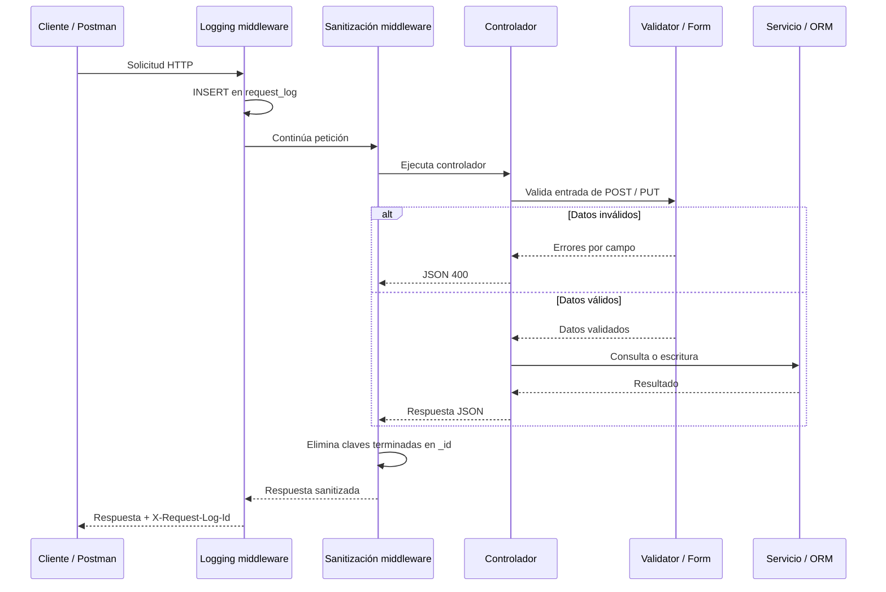

# Actividad 10 — Controllers, Validators y Middleware

La implementación está en `mi_proyecto_routing`. El proyecto antiguo `mi_proyecto` conserva su estado anterior.

## Ejecución

Desde la raíz del repositorio, en PowerShell:

```powershell
.\.venv\Scripts\python.exe -m pip install -r requirements.txt
.\.venv\Scripts\python.exe mi_proyecto_routing\manage.py migrate
.\.venv\Scripts\python.exe mi_proyecto_routing\manage.py runserver
```

La migración `0002_requestlog` crea la tabla `request_log`. Ya se aplicó sobre la base local durante esta implementación. No cambia los registros del juego.

**Solo si creaste una base nueva**, carga los ejemplos antes de iniciar el servidor:

```powershell
.\.venv\Scripts\python.exe mi_proyecto_routing\manage.py loaddata datos_iniciales
```

No vuelvas a cargar el fixture sobre tus datos de trabajo: sobrescribe los registros que tengan los mismos IDs. En otra máquina puedes crear primero el entorno con `py -m venv .venv`.

## Arquitectura y archivos

Se eligió subdividir las vistas en módulos por recurso, una de las dos alternativas del ejercicio 1. Las rutas anteriores funcionan con y sin barra final.

| Archivo dentro de `mi_proyecto_routing/juego` | Responsabilidad |
|---|---|
| `models.py` | Entidades y relaciones del juego; nuevo modelo `RequestLog`. |
| `views/personajes.py` | Controladores de personajes y sus habilidades. |
| `views/habilidades.py` | Controladores del catálogo de habilidades. |
| `views/usuarios.py` | Lectura de usuarios y sus personajes. |
| `views/logs.py` | Consulta de los últimos 100 logs, solo con `DEBUG=True`. |
| `views/__init__.py` | Exporta los controladores para conservar las rutas existentes. Reemplaza el antiguo archivo `views.py`. |
| `forms.py` | Validators de todos los POST y PUT: personajes, habilidades y asignaciones. |
| `api.py` | Adaptación HTTP: JSON, Content-Type, errores y métodos permitidos. |
| `exceptions.py` | Errores esperados compartidos entre controladores y servicios. |
| `services.py` | Consultas optimizadas y operaciones sobre perfiles y habilidades adquiridas. |
| `serializers.py` | Convierte modelos a datos de salida y calcula bonificaciones. No utiliza DRF. |
| `middleware.py` | Logging previo y sanitización posterior. |
| `migrations/0002_requestlog.py` | Crea la tabla de auditoría. |
| `admin.py` | Incluye consulta de logs con filtros y búsqueda. |
| `test_actividad_10.py` | Pruebas de validación, logging y sanitización. |

Los middlewares están registrados primero en `settings.py`, en el orden logging → sanitización → middlewares de Django. Así el logging también registra respuestas que los siguientes componentes resuelvan anticipadamente. En respuesta se recorre el orden inverso.



## Validación y contrato

- **POST `/api/personajes`**: requiere `perfil_id`, `nombre`, `tipo`, `descripcion`, `ataque`, `defensa`, `estamina`.
- **PUT `/api/personajes/{id}`**: requiere todos los campos anteriores excepto `perfil_id`; conserva la relación con el perfil y las habilidades. PUT exige el recurso completo.
- **Tipos de personaje**: `guerrero`, `maga`, `elfo`, `asesino`, más `enano`, `arquera` y `orco` para mantener los datos iniciales del proyecto.
- **Atributos base**: enteros JSON entre 0 y 100 inclusive. Las bonificaciones de habilidades pueden producir valores efectivos fuera de ese rango; el límite corresponde a los atributos base.
- **POST y PUT `/api/habilidades[/{id}]`**: requieren `nombre`, `descripcion`, `incremento_ataque`, `incremento_defensa`, `incremento_estamina`; `tipo` es opcional. Los incrementos admiten enteros con signo entre −2147483648 y 2147483647.
- **POST `/api/personajes/{id}/habilidades`**: requiere `habilidad_id` positivo; `nivel` es opcional, por defecto 1, entre 1 y 2147483647.
- Se rechazan campos desconocidos, textos con tipos incorrectos, `null`, booleanos como números, decimales y strings como `"20"` en campos numéricos. `nombre` admite hasta 100 caracteres.
- Los cuerpos deben ser objetos JSON con `Content-Type: application/json`. Un JSON inválido devuelve 400 y otro Content-Type devuelve 415.
- Las referencias válidas en formato pero inexistentes devuelven 404; adquirir una habilidad duplicada devuelve 409. Un método no permitido devuelve 405 con `Allow`.

Ejemplo válido para crear:

```json
{
  "perfil_id": 1,
  "nombre": "Maga de prueba",
  "tipo": "maga",
  "descripcion": "Ejemplo para la demostración",
  "ataque": 30,
  "defensa": 40,
  "estamina": 70
}
```

Ejemplo de error al enviar `"ataque": "30"`:

```json
{
  "error": "Datos inválidos",
  "errors": [
    {"field": "ataque", "messages": ["Debe ser un número entero JSON."]}
  ]
}
```

Los errores usan una lista de objetos `field` / `messages`. Esto conserva errores sobre `perfil_id` y `habilidad_id`: sus nombres son valores, por lo que no desaparecen al sanitizar las claves JSON.

**Cambios respecto a la actividad 09:** `tipo` de personaje ahora es obligatorio, los atributos base se limitan a 100 y `perfil_id` deja de aparecer en las respuestas. Sigue siendo necesario enviarlo al crear. La clave primaria `id` se conserva. Usa la nueva colección para esta entrega; la antigua documenta el contrato anterior.

## Middleware previo: evidencia de logging

`RequestLoggingMiddleware` guarda una fila **antes** de ejecutar el controlador con método, ruta, IP de `REMOTE_ADDR` y fecha. No almacena body, query string ni encabezados. Una IP ausente o inválida se registra como `NULL`; no se confía en `X-Forwarded-For`. Las rutas se recortan a los 255 caracteres del modelo.

Cada respuesta incluye `X-Request-Log-Id`, que corresponde a la fila persistida. Las llamadas con 400, 404 o 405 también se registran. La tabla debe existir: ejecuta `migrate` antes de levantar el servidor.

Para demostrarlo:

1. Envía `GET http://127.0.0.1:8000/api/personajes` en Postman.
2. Copia el encabezado `X-Request-Log-Id`.
3. Envía `GET http://127.0.0.1:8000/api/request-logs` y encuentra esa fila por `id`.
4. Verifica su método, ruta, IP y fecha. La consulta de logs también genera su propia fila.

La ruta de logs solo sirve para la demostración local: devuelve 404 cuando `DEBUG=False`. Puedes comprobar directamente la base:

```powershell
.\.venv\Scripts\python.exe mi_proyecto_routing\manage.py shell
```

```python
from juego.models import RequestLog
RequestLog.objects.count()
list(RequestLog.objects.order_by('-id').values()[:10])
RequestLog.objects.get(pk=123)  # Sustituye 123 por el encabezado recibido.
```

También aparece en `/admin/juego/requestlog/` con un superusuario de Django.

## Middleware posterior: evidencia de sanitización

`SanitizeIdsMiddleware` elimina recursivamente cualquier clave que termine en `_id`, incluso `_id`, en diccionarios y listas JSON. Conserva `id`, valores, atributos base y habilidades. Se aplica a respuestas exitosas y errores; no modifica la base de datos ni el body de entrada.

Puedes mostrar la eliminación real consultando un personaje: `serializers.py` construye `perfil_id`, pero la respuesta final ya no lo incluye. Las pruebas comparan el payload antes y después, y verifican estructuras anidadas.

El middleware conserva respuestas HTML, JSON malformado, respuestas streaming y respuestas ya comprimidas. No agrega contenido a DELETE 204. Actualiza `Content-Length` cuando ya existe.

## Colección de Postman

Importa **`postman/actividad_10.postman_collection.json`**, en formato Collection v2.1, mediante **Import**. No requiere plugins, login ni archivos de entorno adicionales.

La variable `base_url` vale `http://127.0.0.1:8000/api`. Necesita los datos iniciales y `DEBUG=True` para comprobar los logs. Ejecuta las **46 solicitudes en orden** con Collection Runner.

La colección captura automáticamente los IDs de recursos temporales. Comprueba CRUD, bonificaciones, errores por campo, JSON inválido, Content-Type, rangos, tipos y métodos. En cada respuesta revisa el identificador de logging y la ausencia recursiva de claves `_id`. La última solicitud verifica en la base los logs de todas las llamadas de la ejecución, incluidos los errores y los DELETE.

Una ejecución completa elimina el personaje y la habilidad temporales; si la interrumpes pueden quedar creados. Los logs permanecen como evidencia. La consulta devuelve los últimos 100 registros, por lo que conviene ejecutar la demostración sin otra carga concurrente elevada.

Con Newman instalado:

```powershell
newman run postman/actividad_10.postman_collection.json
```

## Verificación realizada

```powershell
.\.venv\Scripts\python.exe mi_proyecto_routing\manage.py test juego
.\.venv\Scripts\python.exe mi_proyecto_routing\manage.py check
.\.venv\Scripts\python.exe mi_proyecto_routing\manage.py makemigrations --check --dry-run
```

- 34 pruebas Django aprobadas sobre una base de pruebas independiente.
- Colección ejecutada con Newman contra Django real en `127.0.0.1:8001`: **46 solicitudes, 171 aserciones, cero fallos, salida 0**.
- Esa ejecución usó una base SQLite temporal mediante `DJANGO_DB_PATH`, sin modificar los registros del juego de la base de trabajo. La variable es opcional; normalmente se usa `mi_proyecto_routing/db.sqlite3`.
- Resumen de evidencia: `postman/resultado_actividad_10.json`.
- No se verificó MySQL ni un despliegue remoto.

## Repaso para el cuestionario

| Concepto | Idea clave |
|---|---|
| Modelo | Define entidades, campos, relaciones e integridad de los datos. |
| Servicio | Agrupa operaciones y reglas del negocio; evita repartirlas entre controladores. |
| Controlador | Recibe HTTP, solicita validación, coordina operaciones y devuelve una respuesta. En Django es una vista. |
| Validator | Comprueba estructura y reglas de entrada antes de escribir. Aquí son Forms y ModelForms. |
| Middleware | Intercepta solicitudes o respuestas para tareas transversales. |
| Preprocesamiento | Se ejecuta antes del controlador: aquí registra la petición. |
| Postprocesamiento | Se ejecuta después del controlador: aquí elimina claves `_id`. |
| Orden | Django recorre MIDDLEWARE hacia abajo en request y hacia arriba en response. |
| Validación y sanitización | La primera rechaza entradas inválidas; la segunda transforma los datos de salida. |
| Separación de responsabilidades | Facilita reutilizar, probar y mantener cada pieza sin mezclar HTTP con validación y negocio. |

Los validators se invocan desde el controlador antes de guardar; no necesitan ser un middleware para ser reutilizables. Un error de entrada termina en 400 sin escritura, pero pasa igualmente por logging y sanitización.
